<p align="center">
  
</p>

<h1 align="center">ghost-infer</h1>

<p align="center">
  <b>Fast local LLM inference for the GPU you already have.</b><br>
  One small Rust program that runs GGUF models on an NVIDIA card, serves an OpenAI-compatible API,<br>
  and comes with a desktop app where the model works on your files.
</p>

<p align="center">
  <a href="#install"><b>Install</b></a> ·
  <a href="#speed">Speed</a> ·
  <a href="#models-bigger-than-your-gpu">The engine</a> ·
  <a href="#the-desktop-app">Desktop app</a> ·
  <a href="#whats-new">What's new</a> ·
  <a href="docs/usage.md">Server API</a> ·
  <a href="docs/how-it-works.md">How it works</a>
</p>

<p align="center">
  <a href="https://www.paypal.com/ncp/payment/WPSFYDSR9HVSY"></a>
</p>

<p align="center">
  
</p>

Most inference engines are built for data centres: many users, big GPUs, batching. ghost-infer is built
for the other case: **one person, one consumer GPU, one model at a time**, and it is tuned for exactly that.

## Speed

<p align="center">
  
</p>

On an 8 GB RTX 2060 SUPER with 16 GB of RAM, on the same GGUF files:

| Generation speed | ghost-infer | llama.cpp | Ollama |
|---|---|---|---|
| Qwen3 8B, 5 GB: fits in the GPU | **70.2 tokens/s** | 64.3 | 66.0 |
| Qwen3.6-35B-A3B, 16.8 GB: bigger than the GPU | **45.3 tokens/s** | 25.1 | 26.1 |
| Qwen3-30B-A3B, 13.7 GB: bigger than the GPU | **38.0 tokens/s** | 23.7 | 21.7 |
| Qwen3-Coder-30B-A3B, 14.7 GB \* | **32.7 / 47.3** | not measured | not measured |
| Qwen3-Coder-Next 80B, 22 GB: bigger than the RAM \* | **11.8 / 14.5** | 9.3 / 12.4 | not measured |

<sub>llama.cpp b11747 and Ollama 0.40.13. Qwen3 8B: GuideLLM, a ~264-token chat prompt and 128 tokens, measured
2026-11-10. The two A3B rows: seven varied prompts (code, an explanation, a code review, a summary, a chat, a word
problem, SQL) through each engine's API, llama.cpp at its best `--n-cpu-moe` setting; Qwen3.6-35B-A3B
(i1-Q3_K_M) measured 2026-11-10. Rows marked \*: tokens/s writing code / writing a long answer, the second (warm)
of two runs, llama.cpp with its automatic GPU split. Method and more results in [Benchmarks](docs/benchmarks.md).</sub>

## Models bigger than your GPU

<p align="center">
  
</p>

A mixture-of-experts model uses only a few of its experts for each token. ghost-infer keeps attention on the GPU
and the experts in RAM, caches on the GPU the ones a reply keeps reaching for, and runs the others on the CPU
meanwhile. So Qwen3.6-35B-A3B (16.8 GB) runs on an 8 GB card at 45 tokens/s, and an 80B model runs at all.

## Long chats stay fast

<p align="center">
  
</p>

Attention runs on the tensor cores, both while the model writes and while it reads a prompt, so a long chat or a
long file pasted in does not slow it down: 49 tokens/s after 64K tokens of context, and a 128K-token prompt read
in about 4 minutes instead of 28. `GHOST_INFER_NO_TC_DECODE=1` and `GHOST_INFER_NO_TC_ATT=1` turn the
tensor-core kernels off.

## Exact speculative decoding

<p align="center">
  
</p>

ghost-infer guesses a few tokens ahead and checks them all in one pass, keeping only the ones the model would have
written itself, so the reply is the same text as plain greedy decoding, only sooner. The guesses come from text
already in the chat (lookup, on by default for models that fit in the GPU: 3.2× on agent work that copies text,
such as editing a file) or from a small draft model (`--draft`). Results are also checked against exact maths and llama.cpp. [More](docs/how-it-works.md)

## A drop-in server

<p align="center">
  
</p>

An OpenAI-compatible `/v1/chat/completions` with streaming and tool calls, so editor plugins, chat apps and agent
harnesses work unchanged: point them at `http://127.0.0.1:8080/v1`. [More](docs/usage.md)

## One small program

<p align="center">
  
</p>

One 3.8 MB file with two Rust dependencies: no Python, no Docker. It compiles its GPU code for your card on first
start.

## Install

**[Download GhostSetup for Windows](https://github.com/affifuddin-hazam/ghost-infer/releases/latest)** and run
it. It needs no administrator rights and nothing else installed. The app starts the server and, the first
time, offers models to download, or uses the GGUF files you already have.

<details>
<summary>Build from source</summary>

```bash
git clone https://github.com/affifuddin-hazam/ghost-infer
cd ghost-infer
cargo build --release
target\release\ghost-infer serve models\Qwen3-8B-Q4_K_M.gguf --gpu
```

Open <http://127.0.0.1:8080> to chat, or point any OpenAI client at `http://127.0.0.1:8080/v1`. Built from
source, it needs the CUDA toolkit's NVRTC: see [Building](docs/building.md).

</details>

## The desktop app

<p align="center">
  
  <br><sub>Real time, not sped up: the desktop app fixing a failing test, Qwen3.6-35B-A3B (Huihui abliterated, i1-Q3_K_M) on an RTX 2060 SUPER (8 GB) with 16 GB of RAM.</sub>
</p>

- **An agent on your files.** The model reads and edits your files and runs commands, asking first,
  with permission modes, a task list and background jobs. [More](docs/desktop-app.md)
- **Voice calls.** Talk with Maya, a companion who answers aloud and remembers your calls, with her own
  model beside the coding one when the GPU has room. Speech and listening run on the same card. The voice
  files (about 3 GB) are on [Hugging Face](https://huggingface.co/affifuddin-hazam/ghost-voice).
  [More](docs/desktop-app.md#voice-calls)
- **English or Chinese.** The desktop app's own words come in either language: Settings, General, Language,
  or follow Windows.

<p align="center">
  
  <br><sub>A voice call, real time: Impish_LLAMA_3B, the voice (maya1 with a voice fine-tune of our own,
  <a href="https://huggingface.co/affifuddin-hazam/ghost-voice">on Hugging Face</a>) and Whisper turbo together on an 8 GB RTX 2060 SUPER. <a href="docs/demo-voice.mp4">With sound</a>.</sub>
</p>

## What's new

New in 0.3.0:

- **Faster on models bigger than the GPU.** The GPU's expert cache now keeps the experts a reply keeps using
  instead of swapping one in on every miss, which made a 16 GB computer read them back from the disk:
  Qwen3.6-35B-A3B on an RTX 2060 SUPER went from 34.7 to 42.1 tokens/s on average. The CPU's workers run below
  normal priority, so the rest of the computer stays responsive while it writes.
- **RAM for experts.** Settings, Models: leave 2 GB (the default) or 4 GB free for your other programs, or use
  all of it. Qwen3.6-35B-A3B on 16 GB used 10.5 GB of RAM before and 3.9 GB now, at the same speed.
- **Experts on the GPU only.** Settings, Models: the CPU runs none of the experts, at some cost in speed.
- **Edit, regenerate, copy.** Edit a message you sent and send it again; regenerate any reply, not only the
  last; copy a message, or select part of it to copy.
- **Plugins it writes itself.** The model can write small tools for its own use (plain Python functions) and
  turn them on; it asks before saving one. Skills, plugins and MCP tools are found when a message needs them
  instead of filling every prompt.
- **LoRA adapters.** `--lora <file>[:scale]` loads an adapter in llama.cpp's GGUF format, on the GPU or CPU.
- **Sleep training (from source, experimental).** Each night it can train what your chats taught into an
  adapter for Qwen3-4B, checked before it is used: the facts learned, general answers unchanged, tools still
  called. Settings, Sleep training shows what it learned and lets you forget any of it. It needs Python and
  PyTorch and runs from a copy of the source (`scripts/nightly`); the installer does not include it yet.

New in 0.2.5:

- **The desktop app in Chinese.** Settings, General, Language: English, 中文, or System to follow Windows. It
  switches at once, no restart. The model still answers in whatever language you write in. Thanks to
  [huai_xin](https://github.com/2424830124) for the translation.

New in 0.2.4:

- **Long chats stay fast on Qwen3.6-35B-A3B.** Its attention (256-wide heads) now runs on the tensor cores,
  both when it writes and when it reads a prompt. On an RTX 2060 SUPER, generation at a 16K context went from
  25.2 to 39.7 tokens/s and at 64K from 12.0 to 40.8; reading a 128K-token prompt takes about 4 minutes
  instead of 27 (81 to 581 tokens/s). `GHOST_INFER_NO_TC_DECODE=1` and `GHOST_INFER_NO_TC_ATT=1` turn the new
  kernels off.
- **Attach files in the desktop app.** Text and code files go with a message: from the + menu, dropped on the
  window, or pasted with Ctrl+V after copying them in Explorer.
- **See a file being written.** While the model writes a file, the reply shows a live line with its name, how
  much is written and for how long, instead of going quiet until the file is done.
- **Smaller fixes in the app.** Each thinking block opens and closes on its own, and the token count and
  speed show only while the model is writing (not while it waits for your OK).

## Models

The app offers these on its first start:

| Model | Download | Good for |
|---|---|---|
| Qwen3.6-35B-A3B | 16.8 GB | Thinks before it answers: coding and agent work (16 GB of RAM) |
| Qwen3-Coder-30B-A3B | 14.7 GB | Answers at once: fast for code |
| Qwen3-4B-Instruct-2507 | 2.5 GB | Computers with less memory |

Other GGUF files of Llama 3, Mistral Nemo, Qwen3, Qwen3-Next, Qwen3.5 / 3.6 and DeepSeek-style models such as
GLM-4.7-Flash run too, in Q3_K to Q8_0 or the 2-bit IQ2 formats: [the full list](docs/building.md#supported-models).
3-bit files stay 3-bit on the GPU, so a 12B Q3_K_M runs on an 8 GB card.

## Requirements

Windows 10 or 11, an NVIDIA GPU from the GTX 10 series on with a current driver, and a CPU with AVX2.

## Documentation

- [Benchmarks](docs/benchmarks.md): the method, long contexts, mixture of experts, speculative decoding
- [The desktop app and the chat page](docs/desktop-app.md)
- [Command line and server API](docs/usage.md)
- [How it works](docs/how-it-works.md), and its accuracy
- [Building, requirements and models](docs/building.md): from source, GPU requirements, the installer

## Roadmap

- Linux support
- More architectures (Gemma) and formats (Q4_0, the other IQ quants)
- Constrained decoding for tool calls

## License

Licensed under either of

- Apache License, Version 2.0 ([LICENSE-APACHE](LICENSE-APACHE) or <https://www.apache.org/licenses/LICENSE-2.0>)
- MIT license ([LICENSE-MIT](LICENSE-MIT) or <https://opensource.org/licenses/MIT>)

at your option.

Unless you explicitly state otherwise, any contribution intentionally submitted for inclusion in the work
by you, as defined in the Apache-2.0 license, shall be dual licensed as above, without any additional
terms or conditions.

The chat page includes [three.js](https://threejs.org) (MIT, [`src/vendor/three.LICENSE`](src/vendor/three.LICENSE))
and the [Instrument Sans](https://github.com/Instrument/instrument-sans) typeface (SIL Open Font License 1.1,
[`src/vendor/instrument-sans.LICENSE`](src/vendor/instrument-sans.LICENSE)). The installer includes NVIDIA's
NVRTC under the CUDA Toolkit EULA ([`installer/THIRD-PARTY.txt`](installer/THIRD-PARTY.txt)).

The speed race names the engines it measures with their marks: llama.cpp's from
[ggml-org/llama-brand](https://github.com/ggml-org/llama-brand), and Ollama's. They belong to their projects,
which do not endorse ghost-infer.
