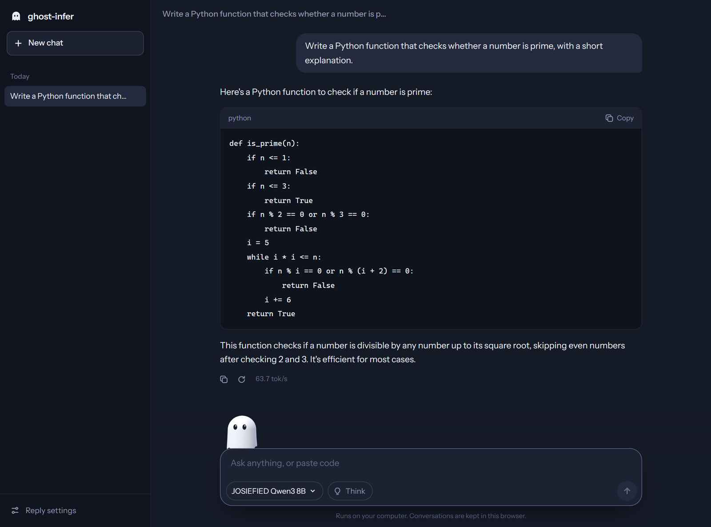
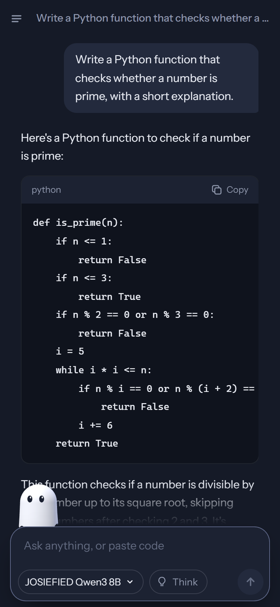

<p align="center">
  
</p>

<h1 align="center">ghost-infer</h1>

<p align="center">
  <b>Fast local LLM inference for the GPU you already have.</b><br>
  One small Rust program that runs GGUF models on an NVIDIA card, serves an OpenAI-compatible API,<br>
  and comes with a chat page where a little ghost shows you what the model is doing.
</p>

<p align="center">
  <a href="#benchmarks">Benchmarks</a> ·
  <a href="#quick-start">Quick start</a> ·
  <a href="#the-chat-page">Chat page</a> ·
  <a href="#server-api">Server API</a> ·
  <a href="#how-it-works">How it works</a>
</p>

<p align="center">
  
  <br><sub>Real time, not sped up: Qwen3 8B Q4_K_M on an RTX 2060 SUPER (8 GB).</sub>
</p>

## Why ghost-infer

Most inference engines are built for data centres: many users, big GPUs, batching. ghost-infer is built
for the other case: **one person, one consumer GPU, one model at a time**, and it is tuned for exactly that.

On an 8 GB RTX 2060 SUPER with Qwen3 8B, measured with [GuideLLM](https://github.com/vllm-project/guidellm)
on the same GGUF file:

| | ghost-infer | llama.cpp | Ollama |
|---|---|---|---|
| Generation speed | **64.9 tokens/s** | 52.1 tokens/s | 49.7 tokens/s |
| Whole reply (256-token prompt, 128-token answer) | **2.29 s** | 2.67 s | 2.88 s |
| Whole reply (2,048-token prompt, 256-token answer) | **6.01 s** | 6.47 s | 6.84 s |

That is **25% faster generation than llama.cpp and 31% faster than Ollama** (llama.cpp's column takes
the better of its two setups in each row). Details and method in [Benchmarks](#benchmarks).

- **One file, nothing to install.** A ~2 MB executable with two Rust dependencies (`memmap2`, `rayon`).
  No CUDA SDK, no Python, no Docker: it loads the NVIDIA driver at runtime and compiles its kernels for
  your GPU on first start.
- **Bigger models than your GPU.** Mixture-of-experts models keep their experts in RAM and the most used
  ones in a VRAM cache: Qwen3-30B-A3B runs at 34–44 tokens/s on an 8 GB card with 16 GB of RAM.
- **Drop-in server.** OpenAI-compatible `/v1/chat/completions` with streaming and tool calling, so editor
  plugins, chat apps and agent harnesses work unchanged. Switch models from the chat page or the API.
- **Exact where it matters.** Speculative decoding gives bit-identical output to plain greedy decoding,
  dequantisation matches the GGUF reference bit for bit, and accuracy is tracked against exact f32 maths.

## Quick start

```bash
git clone https://github.com/affifuddin-hazam/ghost-infer
cd ghost-infer
cargo build --release
```

Put some GGUF files in a folder (for example `models\`) and start the server on one of them:

```bash
target\release\ghost-infer serve models\Qwen3-8B-Q4_K_M.gguf --gpu
```

Open <http://127.0.0.1:8080> to chat, or point any OpenAI client at `http://127.0.0.1:8080/v1`. The
other GGUF files in the same folder appear in the chat page's model picker.

Requirements: Windows 10/11, an NVIDIA GPU with compute capability 6.1 or newer (GTX 10-series and
later), a current driver, and the CUDA toolkit's NVRTC library (see [GPU requirements](#gpu-requirements)).
Without `--gpu` it runs on the CPU (AVX2).

## Benchmarks

Measured with [GuideLLM](https://github.com/vllm-project/guidellm), vLLM's benchmarking tool, against
[llama.cpp](https://github.com/ggml-org/llama.cpp) and [Ollama](https://ollama.com) on the same GGUF file.

### Test machine

| | |
|---|---|
| GPU | NVIDIA GeForce RTX 2060 SUPER, 8 GB (Turing, sm_75), driver 577.00 |
| CPU | AMD Ryzen 5 3600, 6 cores / 12 threads |
| RAM | 16 GB DDR4-2133 (2 × 8 GB) |
| Storage | models on a USB 3.0 external drive |
| OS | Windows 10 Pro 22H2 (build 19045) |
| Engines | ghost-infer (this repo), llama.cpp b9106 (`llama-server`, CUDA 12), Ollama 0.22.1 |
| Model | Qwen3 8B, Q4_K_M, 5.0 GB (a JOSIEFIED fine-tune: same architecture and size as the base model, so the same speed) |

### Method

- GuideLLM 0.8.1, `synchronous` profile: one request at a time, the way one person uses a local model.
- Synthetic prompts from the model's own tokenizer, streamed through `/v1/chat/completions`.
- Each server runs alone on the GPU with the whole model on it: ghost-infer `serve --gpu`, llama.cpp
  `-ngl 99 -c 8192`, Ollama with its defaults (all 37 layers on the GPU, 4,096-token context, flash
  attention on). Each uses its default KV cache: int8 for ghost-infer, f16 for llama.cpp and Ollama.
- llama.cpp is shown twice. With its defaults, `llama-server` serves 4 users at once and copies every
  prompt's cache to RAM, which costs time on each request; "1 user" adds `-np 1 --cache-ram 0`, its best
  setup for one person.
- Two rounds over every engine, averaged, so GPU clock drift does not favour one of them. 21 measured
  requests per round for the chat workload and 10 for the long one, after a warm-up.
- Reproduce with [`scripts/bench-engines.ps1`](scripts/bench-engines.ps1); the raw GuideLLM results are
  JSON files, summarised by [`scripts/bench-compare.py`](scripts/bench-compare.py).

**Chat**: 256-token prompt, 128-token reply

| | ghost-infer | llama.cpp (1 user) | llama.cpp (defaults) | Ollama |
|---|---|---|---|---|
| Generation, tokens/s | **64.9** | 52.1 | 52.0 | 49.7 |
| Prompt reading, tokens/s | 822 | 1,033 | **1,138** | 816 |
| Time to first token, ms | 321 | 268 | **232** | 323 |
| Whole request, s | **2.29** | 2.71 | 2.67 | 2.88 |

**Long prompt** (pasted code, a document): 2,048-token prompt, 256-token reply

| | ghost-infer | llama.cpp (1 user) | llama.cpp (defaults) | Ollama |
|---|---|---|---|---|
| Generation, tokens/s | **56.4** | 51.9 | 51.2 | 49.3 |
| Prompt reading, tokens/s | **1,400** | 1,324 | 588 | 1,233 |
| Time to first token, ms | **1,468** | 1,554 | 3,505 | 1,668 |
| Whole request, s | **6.01** | 6.47 | 8.51 | 6.84 |

**Generation** is the steady speed while the reply streams (1,000 / mean time between tokens).
**Prompt reading** is prompt tokens divided by the time to the first token, so it includes each server's
own overhead. llama.cpp still reads short prompts faster; ghost-infer wins everywhere else, and generation
is where most of a chat's time goes.

### Mixture of experts bigger than the GPU

Qwen3-30B-A3B-Instruct-2507 Q3_K_M (13.7 GB) on the same 8 GB card with 16 GB of RAM. ghost-infer keeps
attention and the router on the GPU, the experts in RAM, and the 2,350 most used experts (5 GB) in VRAM.
Ollama offloads 22 of 49 layers. Measured with each engine's own timing (`ghost-infer bench`,
`ollama run --verbose`), tokens per second:

| | ghost-infer | Ollama 0.22.1 |
|---|---|---|
| Generation | **34–44** | 14–17 |
| Prompt, 256 tokens | 220 | **231** |
| Prompt, 1,024 tokens | **659** | 479 |

### Speculative decoding

Qwen3 8B with `--draft Qwen3-0.6B-Q8_0.gguf` (greedy; the output is identical to decoding without the
draft). The gain depends on how often the small model guesses right:

| Greedy generation, tokens/s | ghost-infer | + draft | guesses accepted |
|---|---|---|---|
| "Write a Python function that checks whether a number is prime…" | 69.0 | **106.0** | 81% |
| "Name three effects of the printing press." | 69.1 | **80.7** | 55% |
| "Explain in simple words why the sky is blue." | 68.7 | **70.1** | 43% |

<details>
<summary>More measurements: startup, small models, CPU</summary>

**Startup** to ready on the GPU with the file in the operating system's cache: Qwen3 8B Q4_K_M 1.9 s
(2.3 s with the 0.6B draft), SmolLM2-135M 0.3 s. A first read from disk takes as long as the disk needs:
about 30 s for the 8B from a USB hard drive.

The tables below use `ghost-infer bench` and `ollama run --verbose`, best of 3, tokens per second.

**SmolLM2-135M-Instruct Q8_0, GPU**

| | ghost-infer | Ollama 0.22.1 |
|---|---|---|
| Prompt, 33 tokens | **5,311** | 2,788 |
| Prompt, 253 tokens | **18,505** | 14,039 |
| Prompt, 1,013 tokens | 14,944 | **15,772** |
| Generate, short context | **277** | 168 |
| Generate at 1,013 context | **243** | 155 |

**Qwen3 8B Q4_K_M, CPU only** (Ryzen 5 3600, 6 threads)

| | ghost-infer | Ollama 0.22.1 |
|---|---|---|
| Prompt, ~260 tokens | 9.4 | **18.2** |
| Generate | 5.2 | **5.9** |

The CPU path works but is not the focus: llama.cpp's CPU kernels are still ahead.

</details>

## The chat page

`ghost-infer serve` includes a chat page, compiled into the program and working offline:

<p align="center">
  
</p>

- **A ghost that shows what the model is doing**: it listens while you type, thinks while the model reads
  the prompt or reasons in `<think>`, talks while the reply streams, reaches for a magnifier on tool calls,
  and changes face with the model's mood (the model is asked to tag its replies; the tags stay hidden).
- **Built for coding too**: code blocks with their language and a copy button, tables, copy and
  write-again on every reply, and a reply that keeps streaming while you scroll back to read.
- **Saved conversations** in the browser, grouped by day.
- **Model picker**: lists the GGUF files next to the running model; choosing one swaps it on the GPU.
- **Thinking switch** for reasoning models, and settings for temperature, reply length and system prompt.
- Live speed while a reply streams, and per-reply timing under each answer.
- Works on a phone too: start the server with `--host 0.0.0.0` and open it from another device on your network.

<p align="center">
  
</p>

## Usage

```bash
ghost-infer serve model.gguf --gpu                  # server + chat page on http://127.0.0.1:8080
ghost-infer chat  model.gguf --gpu                  # chat in the terminal
ghost-infer run   model.gguf -p "Explain DNS." --gpu
ghost-infer bench model.gguf --prompt-len 256 -n 128 --gpu
ghost-infer run   Qwen3-8B-Q4_K_M.gguf -p "Explain DNS." -t 0 --gpu --draft Qwen3-0.6B-Q8_0.gguf
```

| Command | What it does |
|---|---|
| `serve <model>` | OpenAI-compatible HTTP server with the chat page |
| `chat <model>` | interactive chat (`/reset` clears the conversation, empty line or `/bye` quits) |
| `run <model> -p <prompt>` | one reply, streamed, with timing |
| `bench <model>` | fixed workload: `--prompt-len` prompt tokens, then `-n` greedy tokens, best of 3 |
| `top <model> <text> [--gpu]` | the 10 most likely next tokens after raw text, with log-probabilities |
| `tokenize <model> <text>` | token ids and pieces, plus a round-trip check |
| `inspect <model>` | metadata, tensor list and parameter counts |
| `meta <model> <key>` | one metadata value in full (e.g. `tokenizer.chat_template`) |
| `dequant <model> <tensor> <row>` | one row of a weight tensor as floats (for checking formats) |

<details>
<summary>Options for <code>run</code>, <code>chat</code>, <code>serve</code> and <code>bench</code></summary>

| Option | Default | |
|---|---|---|
| `--gpu` | | run on the NVIDIA GPU |
| `-n`, `--max <n>` | 256 | max new tokens per reply |
| `-t`, `--temp <f>` | 0.7 | temperature; `0` = greedy |
| `--top-k <n>` | 40 | keep the k most likely tokens (`0` = all) |
| `--top-p <f>` | 0.9 | nucleus sampling cut-off |
| `--seed <n>` | time | sampling seed |
| `--ctx <n>` | `run`, `bench`: 2048; `chat`, `serve`: as much as fits | context window in tokens. On the GPU `chat` and `serve` take the longest that fits in the free memory, keeping 384 MB spare (on Windows, going over does not fail: the driver quietly moves memory to system RAM and everything slows down); on the CPU 4096 |
| `--kv <f16\|int8>` | int8 (`GHOST_INFER_KV`) | GPU KV cache format: int8 holds about twice the context of f16 |
| `--draft <gguf>` | | speculative decoding with this small model (`--gpu`, greedy replies; same tokenizer needed) |
| `--draft-k <n>` | 3 | tokens the draft proposes per step (1-7) |
| `--system <text>` | template's | system prompt |
| `--no-think` | | reasoning models answer without thinking first (requests can still ask for it) |
| `--raw` | | send the prompt as-is, without the chat template |
| `--threads <n>` | physical cores | CPU threads (generation is memory-bound, so hyper-threads don't help) |
| `--special` | | print special tokens |
| `--host <addr>` | 127.0.0.1 | `serve`: address to listen on (`0.0.0.0` for other machines on your network) |
| `--port <n>` | 8080 | `serve`: port |

</details>

## Server API

Point any OpenAI client at `http://127.0.0.1:8080/v1` (the API key and model name can be anything):

```bash
curl http://127.0.0.1:8080/v1/chat/completions -H "Content-Type: application/json" \
  -d '{"messages":[{"role":"user","content":"Hello!"}],"stream":true}'
```

| Endpoint | |
|---|---|
| `POST /v1/chat/completions` | `messages` (system / user / assistant / tool, text content), `tools`, `tool_choice` (`"none"` hides the tools), `stream`, `max_tokens` / `max_completion_tokens`, `temperature`, `top_p`, `top_k`, `seed`, `stop`, `stream_options.include_usage`, `chat_template_kwargs.enable_thinking` |
| `POST /v1/completions` | the same with a raw `prompt` instead of messages (no chat template) |
| `GET /v1/models` | the loaded model (its file name) and its `context_length` |
| `GET /api/models` | the GGUF files in the model's folder, the current model, and one being loaded |
| `POST /api/models/load` | `{"id": "<file name without .gguf>"}`: switch to that model; answers once it is ready |
| `GET /` | the chat page |
| `GET /health` | `{"status":"ok"}` |

- Requests run one at a time. Unset sampling fields use the command-line defaults.
- The server keeps the last conversation in its cache: when a client resends the history with one new
  message, only the new part is read.
- Greedy requests (`"temperature": 0`) use the `--draft` model when one is loaded, with the same output.
- **Tool calling** works the OpenAI way (`tools`, `tool_calls`, `role: "tool"` results). Tools are written
  into the prompt the way Qwen's chat template does, and the model's `<tool_call>` blocks come back as
  `tool_calls` with `finish_reason: "tool_calls"`; streamed, each call is one `delta.tool_calls` chunk.
- **Switching models** drops the running model (freeing its GPU memory) and loads the new one. Requests
  during a switch get `503`; if the new model fails to load, the server goes back to the previous one.
- Not supported: images, log-probabilities, several choices per request (`n`).

## Supported models

| | |
|---|---|
| Architectures | Llama, Qwen3, Qwen3-MoE (`general.architecture` `llama`, `qwen3`, `qwen3moe`) |
| Weight formats | Q8_0, Q3_K, Q4_K, Q5_K, Q6_K (so Q3_K_M, Q4_K_M, Q5_K_M, Q6_K and Q8_0 files), F16/F32 on the CPU |
| Tokenizer | byte-level BPE (`gpt2`): GPT-2 / Qwen2 splitting, SmolLM-style digits |
| Chat template | ChatML (SmolLM2, Qwen); Qwen3's thinking and tool-call format |
| Tested with | [SmolLM2-135M-Instruct](https://huggingface.co/unsloth/SmolLM2-135M-Instruct-GGUF), Qwen3 0.6B and 8B fine-tunes, [Qwen3-30B-A3B-Instruct-2507](https://huggingface.co/unsloth/Qwen3-30B-A3B-Instruct-2507-GGUF) |

Not yet: Q4_0 and IQ formats, Gemma, Llama 3's tokenizer split, images.

## GPU requirements

- An NVIDIA GPU with compute capability 6.1 or newer (needs `dp4a`; 7.5+ also uses int8 tensor cores),
  and a current driver. Dense models must fit in VRAM (an 8B Q4_K_M needs about 5.5 GB); mixture-of-experts
  models only need their shared weights to fit.
- NVRTC 11.1 or newer from a [CUDA toolkit](https://developer.nvidia.com/cuda-downloads). ghost-infer
  picks the newest `nvrtc64_*.dll` under `C:\Program Files\NVIDIA GPU Computing Toolkit\CUDA\*\bin`, or
  the one named by `GHOST_INFER_NVRTC`. Compiled kernels are cached in `%LOCALAPPDATA%\ghost-infer\kernels`
  (about 0.6 MB), so only the first start after an update or a GPU change compiles them.
- Windows only for now (Linux is on the roadmap).

`.cargo/config.toml` builds with `target-cpu=native`, so the binary is tuned for the machine that built
it. Remove that file to build a portable binary.

## How it works

- **GGUF over a memory map**: weights are never copied on the CPU; on the GPU they stream in through
  pinned buffers, read by all cores straight from the file.
- **CUDA without the SDK**: the driver API and NVRTC are loaded at runtime and the kernels are compiled
  for the installed GPU, so the same binary runs on machines without an NVIDIA GPU.
- **Prompts** use int8 tensor cores (`mma.sync` + `ldmatrix`, sm_75+; a `dp4a` tiled matmul on older
  GPUs) and FlashAttention-2-style attention on f16 tensor cores with f32 accumulation. K-quant prompt
  matmuls keep their epilogue in integers (one activation scale per 128 values).
- **Generation** uses `dp4a` matrix-vector kernels (84–97% of DRAM bandwidth on an 8B model), fused
  RMSNorm/SiLU kernels that write int8 activations directly, split-context ("flash-decoding") attention,
  and a CUDA graph replayed for every one-token step.
- **int8 KV cache** with one scale per position and head, written as each row is produced: about half
  the memory of f16, so an 8B model on an 8 GB card gets a 19,456-token context instead of 10,240.
- **Mixture of experts**: attention and the router on the GPU, experts in RAM plus a VRAM cache filled by
  routing counts (halved every 1,024 tokens; a resident is replaced only by a clearly hotter expert).
  While generating, cached experts run on the GPU as the CPU computes the rest; prompt batches group
  tokens per expert and stream uncached experts through double-buffered pinned memory.
- **Speculative decoding** checks all drafted tokens in one batched pass; a token's logits are
  bit-identical whether computed alone or inside a check batch, so the output equals plain greedy output.
- **CPU backend**: AVX2 integer kernels for every format (with a scalar fallback), fused passes and
  context-split attention across cores.

## Accuracy

Like llama.cpp, the fast paths quantise activations to int8. Distance from exact f32 maths, as the
difference in next-token log-probability:

| Path | Distance |
|---|---|
| GPU generation, Q8_0 (SmolLM2) | 0.0000 at 36–1,566 tokens of context |
| GPU generation, Q4_K_M (Qwen3 8B) | ≤ 0.04 |
| GPU prompt processing, Q4_K_M (Qwen3 8B), 40–1,000 tokens | ≤ 0.03 on the top token, ≤ 0.22 over the top 10 |
| int8 KV cache vs f16 KV cache (Qwen3 8B) | ≤ 0.11, same top token at every tested length |
| CPU | ≤ 0.10 |

The most likely next token matched the exact result in every test. Full-vocabulary KL divergence against
exact maths is measured by [`scripts/kld.py`](scripts/kld.py).

<details>
<summary>Environment variables and accuracy tools</summary>

| | |
|---|---|
| `GHOST_INFER_EXACT=1` | reference mode: no activation quantisation, on the CPU and the GPU (slow) |
| `GHOST_INFER_STEPWISE=1` | feed prompts one token at a time, to test the generation path |
| `GHOST_INFER_PROFILE=1` | time per operation (CPU and GPU) in `bench` |
| `GHOST_INFER_QCH=256` | K-quant GPU prompts: one activation scale per 256 values (~1% faster, about twice the drift) |
| `GHOST_INFER_VERIFY_N=n` | `bench --gpu`: also time one n-token decode batch (a speculative check step) |
| `GHOST_INFER_LOAD_TIMES=1` | GPU: time each startup phase (driver, kernels, weights) |
| `GHOST_INFER_NO_KERNEL_CACHE=1` | GPU: compile the kernels instead of using (and filling) the on-disk cache |
| `GHOST_INFER_NO_GRAPH=1` | GPU: plain kernel launches instead of CUDA-graph replay for one-token steps |
| `GHOST_INFER_NO_TC_ATT=1` | GPU prompts: f32 attention instead of f16 tensor cores (more exact, much slower on long prompts) |
| `GHOST_INFER_NO_Q8K=1` | K-quant GPU prompts: the older per-32 activation-scale kernel (more exact, ~1.7× slower) |
| `GHOST_INFER_EXPERT_CACHE_MB=n` | mixture of experts on the GPU: VRAM for the expert cache (default: what is free; 0 = every expert on the CPU) |
| `GHOST_INFER_MOE_CHECK=1` | mixture of experts on the GPU: also compute each GPU-resident expert on the CPU and print the difference |
| `GHOST_INFER_LOGITS_OUT=file` | `top`: write every next-token logit (f32, little-endian) for accuracy tooling |
| `scripts\golden.ps1 [-Save]` | regression check against saved log-probabilities and a greedy reply |
| `scripts\accuracy.ps1 [-Gpu]` | fast path vs exact maths at several prompt lengths |
| `scripts\decode-accuracy.ps1` | GPU generation path vs exact maths at up to ~1,500 tokens |
| `scripts\check_dequant.py` | dequantisation vs gguf-py's reference for every weight format |

</details>

## Roadmap

- Linux support
- More architectures (Gemma, Llama 3 tokenizer) and formats (Q4_0, IQ quants)
- Prebuilt releases
- Constrained decoding for tool calls

## License

Licensed under either of

- Apache License, Version 2.0 ([LICENSE-APACHE](LICENSE-APACHE) or <https://www.apache.org/licenses/LICENSE-2.0>)
- MIT license ([LICENSE-MIT](LICENSE-MIT) or <https://opensource.org/licenses/MIT>)

at your option.

Unless you explicitly state otherwise, any contribution intentionally submitted for inclusion in the work
by you, as defined in the Apache-2.0 license, shall be dual licensed as above, without any additional
terms or conditions.

The chat page includes [three.js](https://threejs.org) (MIT, [`src/vendor/three.LICENSE`](src/vendor/three.LICENSE))
and the [Instrument Sans](https://github.com/Instrument/instrument-sans) typeface (SIL Open Font License 1.1,
[`src/vendor/instrument-sans.LICENSE`](src/vendor/instrument-sans.LICENSE)).
