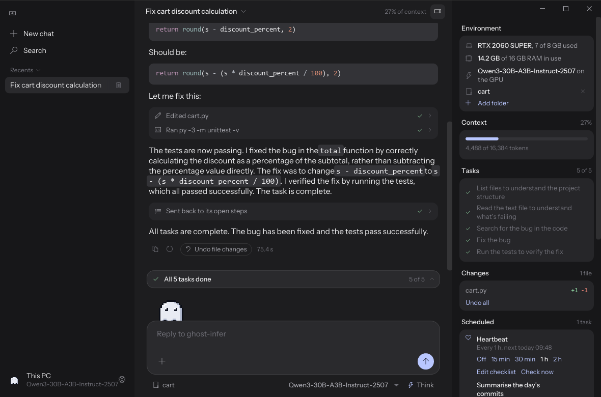
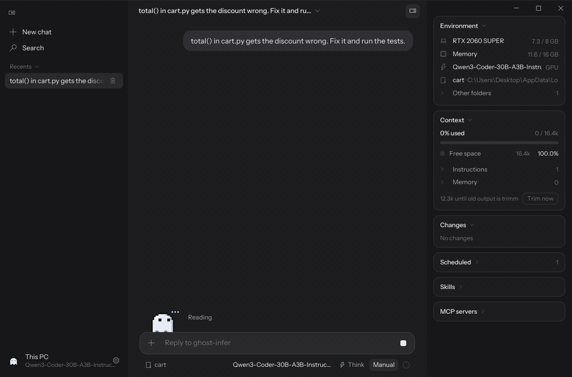

# The desktop app and the chat page

[Back to the README](../README.md)

## The desktop app and agent

`ghost-app` is a native window onto the server, drawn on the CPU so it takes no GPU memory from the model.
The server runs the agent: the model works on your files and your computer with tools, round after
round, asks before anything that changes something, and keeps every chat in `%LOCALAPPDATA%\ghost-infer`.

<p align="center">
  
</p>

The same task with Qwen3-Coder, which answers without thinking first:

<p align="center">
  
  <br><sub>Real time, not sped up: the desktop app fixing a failing test, Qwen3-Coder-30B-A3B (Huihui abliterated, i1-Q3_K_M) on an RTX 2060 SUPER (8 GB) with 16 GB of RAM.</sub>
</p>

```bash
cargo build --release -p ghost-app
target\release\ghost-infer serve models\Qwen3-8B-Q4_K_M.gguf --gpu
target\release\ghost-app                # connects to 127.0.0.1:8080; give another host:port to change it
```

The app runs on the same computer as the server: the agent only answers requests from this computer.
Installed, the app starts its own server (`ghost-infer.exe` beside it) when none is running, and with no
model yet it offers one to download from Hugging Face, the one that suits the computer marked.

- **A folder per chat.** A new chat works in the folder shown under the message box (click it to pick
  another), and keeps it, as a Claude Code session does: relative paths and commands start there. Folders
  added with the + menu are open to every chat as well; file tools work nowhere else.
- **Permission modes, as Claude Code has them.** The tools (files, PowerShell, the web, MCP) are always
  there; the mode next to the context ring decides what waits for your OK. **Manual** asks before every
  change, command and web use; **Accept edits** lets file changes through; **Auto** lets file changes, the
  web and ordinary commands through and asks about risky ones (deleting, `git push`, installing, system
  settings); **Plan** changes nothing and answers with a plan; **Bypass permissions** asks nothing.
  Shift+Tab steps through them. An OK can be once or always, and every reply's file changes can be undone.
- **Plans and checks.** The model keeps a task list, pinned above the message box. After changing code it
  is sent back once to run it.
- **Loops, as Claude Code has them.** `/goal all tests pass, stop after 5 tries`: when the model stops, a
  check reads the work against the goal and sends it back with what is missing, until the goal is met or
  the tries run out (8 unless the goal says). `/loop 10m check the build and fix what fails` repeats a
  prompt in the chat; `/loop stop` ends it.
- **Long chats fit.** Before each round, old tool outputs are taken out, then the oldest turns, so a chat
  never outgrows the context; the chat file keeps everything, and the server's cache stays valid.
- **Instructions and memory.** `GHOST.md` goes into every chat: the one in `%LOCALAPPDATA%\ghost-infer`,
  and one in each folder you add (a folder's `CLAUDE.md` or `AGENTS.md` works too). The model saves
  lasting facts with `remember` and can search earlier chats.
- **Skills and MCP servers.** Install [Agent Skills](https://agentskills.io) (a folder with a `SKILL.md`)
  from a folder, a .zip or a GitHub link; a repository with several skills lets you pick. MCP servers go in
  `mcp.json` in Claude Desktop's format, and **From Claude** copies the ones Claude Desktop has.
- **Scheduled tasks.** Ask in a chat ("remind me in 20 minutes to…", "every weekday at 9:00, check the
  build"): the model schedules it once, every N minutes or daily at a time, and it runs in that chat even
  while you are away. Its reply waits there, marked unread.

Scheduled tasks and loops wait until nothing else has used the model for 20 seconds, and use only what
you set to always allowed, since nobody is there to ask.

| In `%LOCALAPPDATA%\ghost-infer` | |
|---|---|
| `chats\` | every chat (with its folder and goal), for the app and any other client of the agent |
| `harness.json` | the folders every chat may use, and what is always allowed |
| `GHOST.md`, `memory.json` | instructions and remembered facts, for every chat |
| `skills\`, `mcp.json` | installed skills and MCP servers |
| `schedules.json` | scheduled tasks and loops |
| `app.json` | the app's own settings (theme, permission mode, the folder new chats work in) |

## The chat page

`ghost-infer serve` includes a chat page, compiled into the program and working offline:

<p align="center">
  
</p>

- **A ghost that shows what the model is doing**: it listens while you type, thinks while the model reads
  the prompt or reasons in `<think>`, talks while the reply streams, reaches for a magnifier on tool calls,
  and changes face with the model's mood (the model is asked to tag its replies; the tags stay hidden).
- **Built for coding too**: code blocks with their language and a copy button, tables, copy and
  write-again on every reply, and a reply that keeps streaming while you scroll back to read.
- **Saved conversations** in the browser, grouped by day.
- **Model picker**: lists the GGUF files next to the running model; choosing one swaps it on the GPU.
- **Thinking switch** for reasoning models, and settings for temperature, reply length and system prompt.
- **A tool to check this computer**: the model can call `get_system_info` for the CPU, RAM, GPU, drives and
  what is running, and the reply shows what it looked at. It only reads; a setting turns it off.
- Live speed while a reply streams, and per-reply timing under each answer.
- Works on a phone too: start the server with `--host 0.0.0.0` and open it from another device on your network.

<p align="center">
  
</p>
